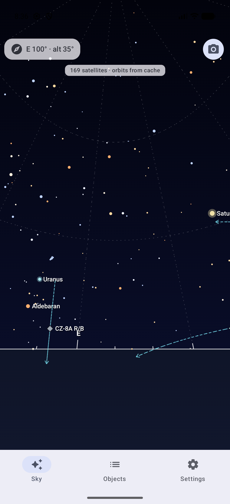
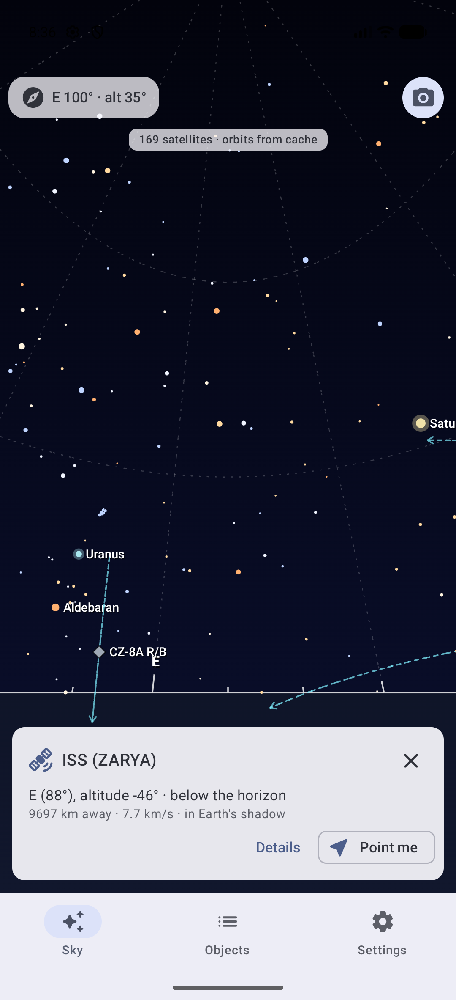
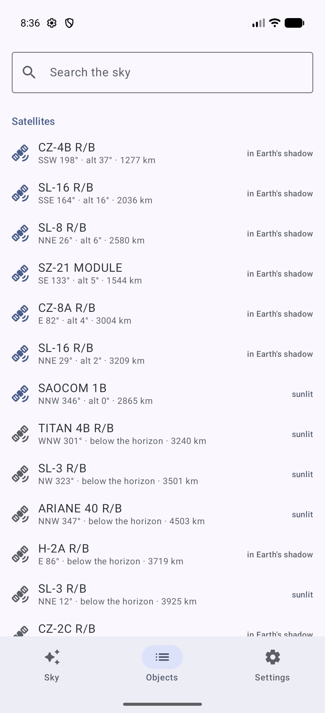
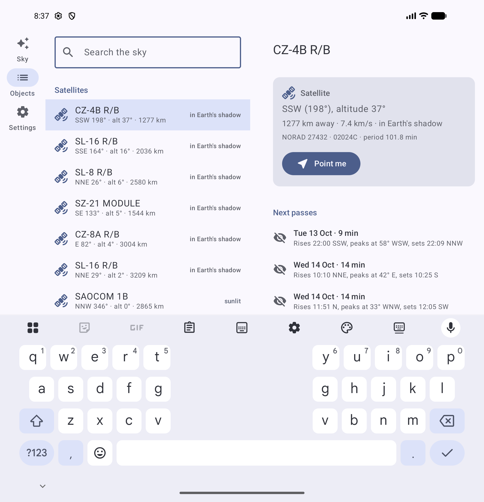
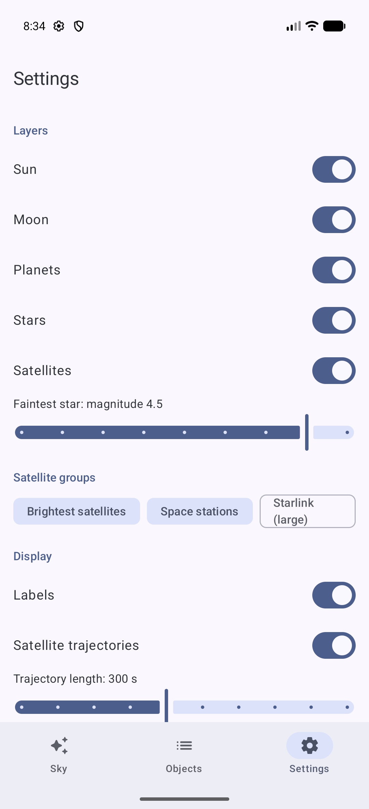
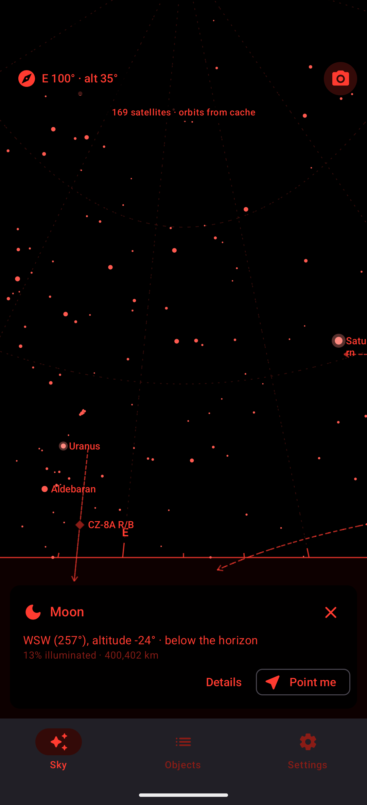
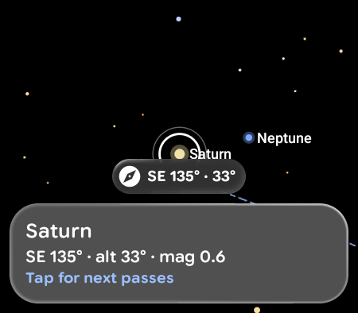
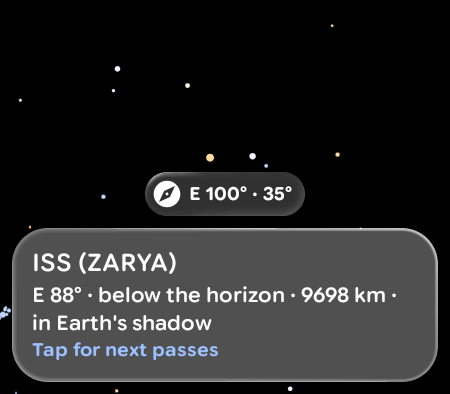
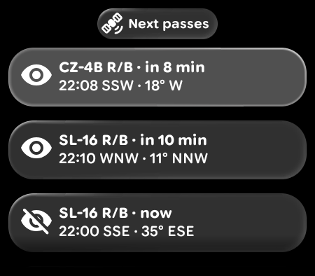
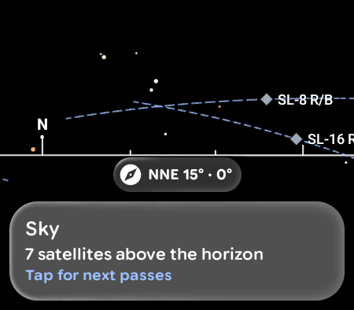

# SkyLens

[](https://github.com/jpcottin/SkyLens/actions/workflows/ci.yml)
[](https://github.com/jpcottin/SkyLens/actions/workflows/release.yml)

<details>
<summary><b>CI details</b> — Lightbuild through the Android CLI, emulator matrix API 34 → 37.2, Android CLI and Emulator Preview legs, snapshot multi-runs</summary>

Every job builds with Lightbuild through the `android` CLI (no Gradle files in the repository).
Instrumented legs run the 39 Compose tests, then a deterministic journey (frozen clock, fixed
position and pose; the HUD, Objects and Settings read back with `android layout`), then a smoke
launch of the minified release APK:

| Leg | Image | Emulator | GPU | Gating |
|---|---|---|---|---|
| API 34, 35, 36 | `google_apis` x86_64 | stable (emulator-runner) | lavapipe | ✅ blocking |
| API 37.0 stable | `google_apis_ps16k` (16 KB page size) | stable | lavapipe | non-blocking |
| API 37.0 canary | `google_apis_ps16k` | canary (`--channel=3`) | auto | non-blocking |
| API 37.1 canary | `google_apis_ps16k` | canary | lavapipe | non-blocking |
| API 37.2 canary | `google_apis_ps16k` | canary | lavapipe, auto | non-blocking |
| Android CLI | `google_apis_ps16k` 37.0 | canary, `android sdk install` / `emulator create` / `emulator start` | default | non-blocking |
| Emulator Preview | `google_apis_ps16k` 37.0 | `emulators;latest` package, binary launched directly | auto | non-blocking |
| Emulator Preview multi-run | `google_apis_ps16k` 37.0 | preview package, 4 snapshot cycles | auto | non-blocking |
| Android CLI multi-run | `google_apis_ps16k` 37.0 | canary, 4 snapshot cycles | auto | non-blocking |

The Android CLI leg runs the Compose tests through Lightbuild's own device-test runner
(`android build test "ui:deviceTest"`) instead of `adb` + `am instrument`.

The two multi-run jobs boot the same AVD four times with quickboot snapshots enabled, launch the
app only in the first cycle, and in every later cycle check that the snapshot brought it back by
itself: process alive, window focused, HUD present in the layout tree. The app is never
relaunched after a restore, since that is the thing being measured. A frozen clock makes every
cycle render the same sky.

Hosted runners are left with ~5 GB after the Lightbuild caches and the three APKs, less than
the emulator needs for its userdata partition, so every emulator job removes unused toolchains
and the build caches before booting. The runner's old `avdmanager` writes `target=android-0`
for minor-versioned packages (android-37.x); the matrix legs update `cmdline-tools` first.
`android build test` / `resolve` exit 1 even when they succeed, so every build goes through
`.github/scripts/android-build.sh`, which reads the verdict from the output.

Also: a daily scheduled run (the CLI, Lightbuild and the preview images move on their own),
dependency review on pull requests, and a tagged release workflow that signs the Lightbuild
release APK and publishes it with its R8 mapping file.

</details>

Raise your phone at the sky and SkyLens shows what is up there: **satellites with their
trajectory**, the **Sun, the Moon and the planets**, and the **bright stars**, drawn over the
camera image and labelled. A list tells you where everything is right now and when each
satellite next passes over you, and *Point me* guides you to it with an arrow at the edge of
the screen. Phone first; Display AI Glasses next.

Everything is computed on the device from a 70 KB star catalogue and the orbital elements
of the satellites: SGP4 for the satellites, Meeus for the Sun and the Moon, the JPL
approximate elements for the planets. The only network traffic is the periodic download of
the element sets from Celestrak, with a bundled copy as fallback.

> **Status:** phone app complete — AR (camera + sensors) and drawn-sky modes, objects list
> with search, satellite pass prediction, compass calibration, settings with layers, night mode
> and a manual position; adaptive to phones, foldables (list-detail when unfolded, split layout
> in tabletop posture), tablets and desktop windows. **Display AI Glasses:** a projected Glimmer
> activity shows the sky window where the wearer looks, with one card for what is in front of
> them and a list of upcoming passes.

## Screenshots

Captured on a Pixel 10 Pro Fold emulator with a frozen clock (2026-10-14 05:00 UTC, Vancouver)
through the debug launch extras described below, so the pictures are reproducible.

<p>



</p>
<p>

</p>
<p>


</p>

On the Display AI Glasses emulator (the phone's projection display, 450 × 394 at 160 dpi):

<p>




</p>

## What it shows

- **Satellites** — the Celestrak *visual* group (the ~150 brightest objects) and the *space
  stations* group by default, Starlink optionally. Each is a diamond with its name, a dashed
  trajectory for the next minutes with an arrow in the direction of travel, dimmed when the
  satellite is in the Earth's shadow. The card and the detail screen give the slant range,
  the speed, the NORAD number and the orbital period.
- **Sun and Moon** — the Moon is drawn with its phase (illuminated fraction, waxing or
  waning) and corrected for parallax, which moves it by up to a degree.
- **Planets** — Mercury to Neptune, coloured and labelled, with an approximate magnitude.
- **Stars** — every star to magnitude 5.0 (1 637 of them) from the HYG database, coloured by
  their B−V index, the named ones labelled; the faintest magnitude drawn is a setting.
- **Horizon** — the horizon line with a tick every 10° and the cardinal points; in the drawn
  mode an altitude/azimuth grid and shaded ground.
- **Passes** — for any satellite, the passes over the next two days: rise, culmination and
  set times with their compass directions, duration, and whether the pass is *visible*
  (the satellite sunlit while the observer is in twilight or night).
- **Point me** — pick an object and an arrow at the edge of the screen points the way
  until it is in view, where a ring marks it.
- **Compass calibration** — phone magnetometers drift. Select something you can see, point
  the camera at it and tap *Align*: the heading correction is computed from that one
  sighting and kept in Settings, where it can also be adjusted by hand or reset. A banner
  asks for the figure-eight motion when the platform reports low compass accuracy.

## How it works

```
                      ┌────────────────────────── astro (pure Kotlin, no Android) ──────────────────────────┐
 Celestrak TLE ──►  Tle.parseAll ──► Sgp4 ──► TEME ──┐                                                       │
                                                     ├─► ECEF ──► ENU ──► azimuth / elevation ──► SkySnapshot │
 Meeus (Sun, Moon), JPL elements (planets) ──► ECI ──┘                                                       │
 HYG catalogue (RA/Dec J2000) ──► precession ──► hour angle ──► azimuth / elevation ─────────────┘           │
                      └──────────────────────────────────────────────────────────────────────────────────────┘
                                                                          │
 rotation-vector sensor ──► DevicePose (forward, up in ENU) ──► SkyCamera ─┤
 Camera2 characteristics ──► field of view ──► FovFit ────────────────────┘──► Canvas overlay on the viewfinder
```

- **`astro`** is a pure-Kotlin module with no Android dependency: two-line element parsing,
  an SGP4 propagator ported from the Vallado reference implementation (near-Earth orbits;
  deep-space objects are skipped), Julian dates and sidereal time, frame conversions
  (TEME → ECEF → East-North-Up), Sun and Moon from Meeus' *Astronomical Algorithms*, planets
  from the JPL approximate Keplerian elements, J2000 → date precession for the stars, the
  bundled star catalogue, a pass predictor (coarse stepping, bisection on the horizon
  crossings, cylindrical Earth-shadow test), and the pinhole `SkyCamera` that projects a sky
  direction to normalised screen coordinates and back.
- **`ui`** is the Android library: the data sources (rotation-vector sensor with display
  rotation remapping and magnetic declination, fused location, Camera2 field of view,
  Celestrak repository with a disk cache and the bundled fallback, Preferences DataStore
  settings), the `SkyViewModel` that recomputes the sky twice a second, and the Compose UI.
- **`app`** is the application shell (manifest, application id, R8 configuration).

Accuracy, checked in the unit tests against the `python-sgp4` library and `skyfield` with the
JPL DE421 ephemeris: satellite positions agree to a millimetre at the TLE epoch, the Sun to
2′, the Moon to 6′ including parallax, the planets to a few arcminutes (Saturn ≈ 10′), the
stars to 6′ (nutation and aberration are ignored). Timing uses UTC for UT1 and TT; the
difference is under a second.

## The UI

- **Sky** — the camera viewfinder (CameraX Compose) with the overlay on top. The HUD shows
  where the camera points; the toggle switches to the drawn sky, which you pan by dragging:
  that is also what the emulator, the previews and the UI tests use. Tap an object to select
  it; the card offers *Details* and *Point me*.
- **Objects** — searchable list: satellites (above the horizon first), then Sun, Moon and
  planets, then the bright named stars that are up. Selecting one opens the detail with the
  next passes.
- **Settings** — layers, faintest star magnitude, satellite groups, labels and trajectory
  length, red **night mode**, camera passthrough, the compass correction, a fixed position
  for when there is no location, the minimum pass altitude, and the orbit data status with a manual refresh.

### Adaptive layouts

- The navigation suite scaffold shows a bottom bar on phones and a rail on tablets, unfolded
  foldables and desktop windows.
- Objects and Detail are a Navigation 3 list-detail pair: stacked on a phone, side by side
  (with a placeholder until something is selected) when the window is at least 840 dp wide.
- In **tabletop posture** (foldable half open with the hinge horizontal) the sky takes the
  upper half, where the camera points at the sky, and the lower, flat half shows the
  selected object's card or the objects list.
- Every screen has `@Preview`s for phone, foldable, tablet and desktop, light and dark,
  landscape and the folded cover screen, plus previews of every state (no location, no
  camera, selected object, night mode, loading passes, missing object, orbit update error).

## On Display AI Glasses

When glasses are connected, the sky HUD on the phone shows a *Show on glasses* button. The
projected activity (`GlassesActivity`, declared with `xr_projected`) runs on the phone but its
context is the glasses': the rotation-vector sensor it reads is the one in the glasses, so the
**sky window follows the wearer's head**. Location still comes from the phone.

Built with Jetpack Compose Glimmer for the additive display: pure black root, the overlay drawn
with 18 sp labels and larger markers, and **one bottom-aligned card** naming what is in front of
the wearer (a satellite, a planet, the Moon or a bright star within a few degrees of the centre,
or the target chosen with *Point me* on the phone). A tap on the card switches to the **next
passes** list for every loaded satellite, visible passes first; selecting one makes it the target
and returns to the sky; system back also returns.

```sh
# Deterministic launch on the glasses (debuggable builds), from the paired phone AVD:
adb -s emulator-5554 shell am start --display 9 -n com.jpcottin.skylens/.ui.glasses.GlassesActivity \
  --el skylens.time 1791954000000 --es skylens.location "49.2827,-123.1207,70" --es skylens.pose "100,35,0"
# The lens is the phone's virtual ProjectionDisplay (the glasses AVD's own framebuffer stays black):
LENS=$(adb -s emulator-5554 shell dumpsys SurfaceFlinger --display-id | grep 'displayName="ProjectionDisplay"' | awk '{print $2}')
adb -s emulator-5554 shell screencap -d "$LENS" -p /sdcard/lens.png && adb -s emulator-5554 pull /sdcard/lens.png
```

## Deterministic launches

Debuggable builds honour launch extras that freeze the inputs, which is how the screenshots
above and the CI journey are produced:

```sh
adb shell am start -n com.jpcottin.skylens/.MainActivity \
  --el skylens.time 1791954000000 \
  --es skylens.location "49.2827,-123.1207,70" \
  --es skylens.pose "100,35,0" \
  --ez skylens.map true
```

`skylens.time` freezes the clock (epoch millis), `skylens.location` is `lat,lon[,altitude]`,
`skylens.pose` is `azimuth,elevation[,roll]` in degrees, `skylens.map` starts in the
drawn-sky mode, `skylens.select` selects an object by id (`sat:25544`, `moon`,
`planet:saturn`), `skylens.night` forces the red night mode and `skylens.tab` opens
`sky`, `objects` or `settings` first. Release builds ignore them.

## Build system: Lightbuild and the Android CLI

There are no Gradle files in this repository. The project is described by
`project.lightbuild.yaml` and one `lightbuild.yaml` per module, and built with the
[Android CLI](https://developer.android.com/tools/agents/android-cli):

```sh
export ANDROID_CLI_BUILD=true
android build "app:app-debug.apk"       # debug APK
android build "app:app-release.apk"     # R8-minified release APK
android build test "astro:hostTest"     # 58 astronomy engine tests on the JVM
android build test "ui:hostTest"        # 52 ui unit tests on the JVM
android build test "ui:deviceTest"      # 39 Compose UI tests on the connected device
android run --apks app/build/outputs/apk/debug/app-debug.apk
```

Lightbuild 0.0.20-alpha02 notes: `platform: jvm` modules cannot be exported yet, so `astro`
is declared as an Android library that happens to contain no Android code; the CLI's exit
code is unreliable for `test`, `query` and `resolve`, so CI runs every build through
`.github/scripts/android-build.sh`, which reads the verdict from the output. See
[AGENTS.md](AGENTS.md) for the full list.

## Testing

| Suite | Where | What |
|---|---|---|
| `astro:hostTest` | JVM | SGP4 against `python-sgp4` reference states (position to 1 µm, velocity to 1 nm/s); Sun, Moon and planets against skyfield/DE421 at six instants and three sites; sidereal time; frames; TLE parsing and checksums; star catalogue; pass prediction; camera projection; the sky engine's determinism |
| `ui:hostTest` | JVM | `SkyViewModel` with fakes (location states, debug overrides, AR/map modes, selection, settings, passes); `TleRepository` with MockWebServer (bundled fallback, cache, courtesy interval, failures); FOV fitting; device pose from rotation matrices and declination; debug extras parsing; the glasses model (which object gets the lens card, pass ordering, countdowns); the sensor fallback from the glasses to the phone |
| `ui:deviceTest` | emulator | Compose UI tests: sky HUD, overlay semantics, tap hit-testing, selected card, location and camera prompts; objects list, search and sections; detail with passes; settings switches, groups, manual position validation, orbit refresh; navigation between tabs, list → detail → *Point me* → sky; the Glimmer glasses screen (heading chip, focused-object card, tap to the pass list, pass selection, loading and empty states) |
| CI journey | emulator | Launches the debug APK with frozen inputs, reads the HUD, the Objects and the Settings tabs back with `android layout`, then smoke-launches the signed release APK and checks the process survives |
| CI multi-runs | emulator | Four snapshot cycles on the preview and the canary emulators: the app launched once, then checked alive and rendering after every restore |

## Data and credits

- Orbital elements: [Celestrak](https://celestrak.org) GP data, fetched at most once every
  two hours per group as their usage policy asks; a snapshot is bundled for offline use.
- Stars: the [HYG database](https://github.com/astronexus/HYG-Database) v4.1 by David Nash,
  CC BY-SA 4.0, cut at magnitude 5.0.
- Sun and Moon: Jean Meeus, *Astronomical Algorithms*, 2nd ed. Planets: E. M. Standish,
  *Keplerian Elements for Approximate Positions of the Major Planets* (JPL).
- SGP4: David Vallado's reference implementation ("Revisiting Spacetrack Report #3").

## Android development skills applied

- **adaptive** — navigation suite scaffold, list-detail scene strategy, tabletop posture from
  `currentWindowAdaptiveInfo()`, form-factor previews.
- **navigation-3** — typed keys, `NavDisplay` with the saveable-state and ViewModel-store
  decorators, scene strategies.
- **edge-to-edge** — `enableEdgeToEdge()` with `safeDrawingPadding` on the HUD and cards.
- **camerax** — `CameraXViewfinder` bound to the lifecycle for the passthrough.
- **display-glasses-with-jetpack-compose-glimmer** — projected activity, `GlimmerTheme` with
  Google Sans Flex, `Card`, `TitleChip`, `ListItem` and `GlimmerLazyColumn`, black root,
  one thing at a time, system back to leave the list.
- **testing-setup** — JVM, instrumented and journey tests, previews for every state.

## License

MIT, see [LICENSE](LICENSE). The star catalogue keeps its CC BY-SA 4.0 licence.
